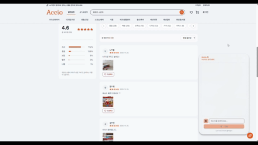
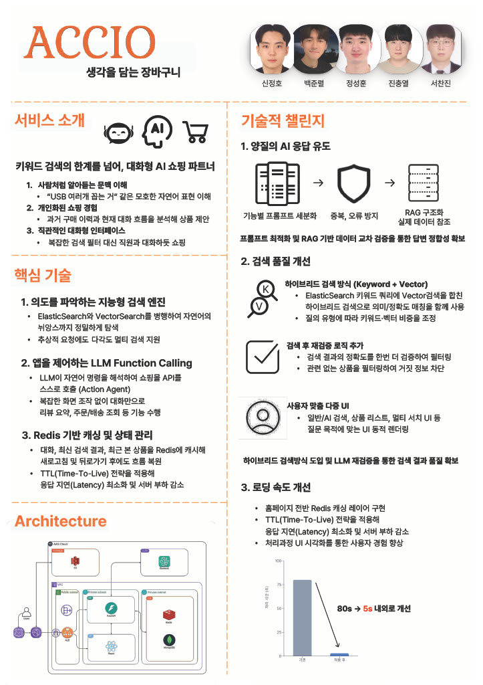

# Accio -생각을 담는 장바구니-

떠오르는 대로 검색하는, AI 자연어 검색 쇼핑몰

사용자의 '의도'를 이해하는 AI 검색 비서가 탑재된 E-Commerce 플랫폼입니다.

> 이 폴더는 jsh. 포트폴리오 안의 Accio 프론트(`#/accio`)입니다. 백엔드는 [`Portfolio/backend/accio`](../../../../backend/accio), 팀 프로젝트 원본 정적 빌드는 [`public/accio-v1`](../../../public/accio-v1)에 있습니다.

## 목차
- [프로젝트 개요](#프로젝트-개요)
- [서비스 소개](#서비스-소개)
- [아키텍쳐](#아키텍쳐)
- [포스터](#포스터)

## 프로젝트 개요

### 프로젝트 기간
2025.10.29 - 2025.11.29

### 팀원 소개

### 프로젝트 링크
- 포트폴리오 안 Accio: https://accio-project-one.vercel.app/#/accio
- 팀 프로젝트 원본(v1, 목 모드): https://accio-project-one.vercel.app/accio-v1/
- 서비스 당시 주소 https://accio.life/ 는 서버가 닫혀 지금은 열리지 않습니다.

## 서비스 소개

### 자연어 기반 검색

### 상품 및 리뷰 분석

### 사용자 의도 파악 서비스

## 아키텍쳐

## 포스터

